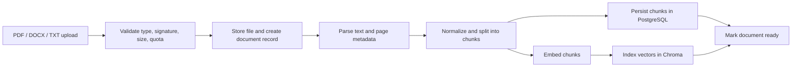
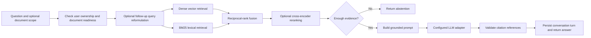
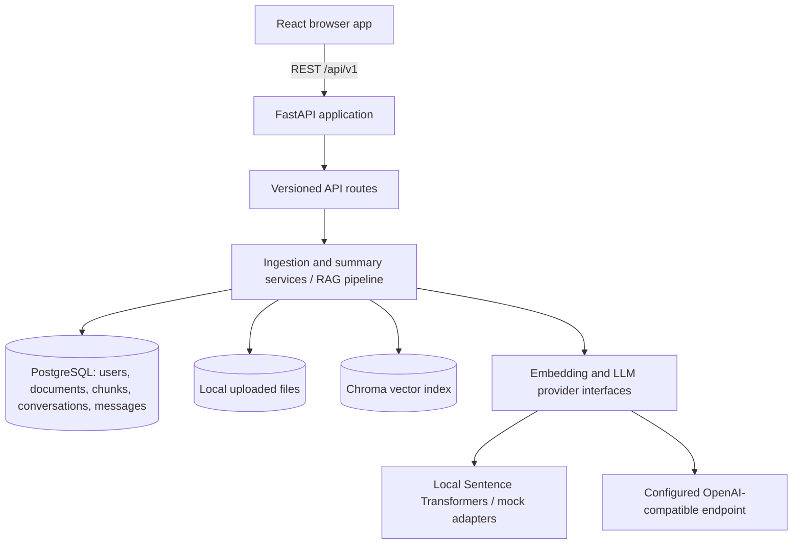

# DocuMind

<div align="center">


**A self-hostable document intelligence app for uploading, searching, chatting with, and summarizing your files.**

[Architecture](docs/ARCHITECTURE.md) · [User guide](docs/USER_GUIDE.md) · [API specification](docs/API_SPEC.md) · [Documentation index](docs/INDEX.md)

</div>

DocuMind accepts PDF, DOCX, and UTF-8 text files. It extracts and chunks their text, indexes chunks for retrieval, and lets authenticated users ask questions with citations into the retrieved source passages. The application also keeps conversation history, produces document summaries, and compares multiple documents.

> The animated heading is provided by an external SVG service. The rest of the documentation and application do not depend on it.

## Contents

- [What it does](#what-it-does)
- [How it works](#how-it-works)
- [Architecture](#architecture)
- [Technology](#technology)
- [Repository structure](#repository-structure)
- [Run with Docker Compose](#run-with-docker-compose)
- [Run locally](#run-locally)
- [Configuration](#configuration)
- [HTTP API](#http-api)
- [Data model and persistence](#data-model-and-persistence)
- [Security and privacy](#security-and-privacy)
- [Known limitations](#known-limitations)
- [Development and checks](#development-and-checks)
- [Documentation map](#documentation-map)
- [License](#license)

## What it does

- **Accounts and sessions:** Register, log in, and use expiring JWT access tokens. Passwords are hashed before persistence.
- **Document library:** Upload PDF, DOCX, and TXT files. Track upload, processing, ready, and failed states; retry failed ingestion; delete documents.
- **Document parsing and indexing:** Extract page-aware text, split it into overlapping chunks, create embeddings, and store vectors with owner and document metadata.
- **Grounded chat:** Ask questions across all ready documents owned by the signed-in user, or scope a query to selected documents.
- **Hybrid retrieval:** Combine dense vector retrieval with BM25 lexical search using reciprocal-rank fusion when hybrid search is enabled. Optional query reformulation and cross-encoder reranking can be configured.
- **Citations and abstention:** Validate source markers against retrieved chunks and return citation metadata/snippets. If the evidence is insufficient, the pipeline can abstain instead of presenting unsupported citations.
- **Conversation history:** Persist chat turns and retrieval metadata, resume conversations, rename them, and delete them.
- **Summaries and comparison:** Generate a source-grounded summary of one document or compare between two and ten documents.
- **Operational visibility:** Health and readiness endpoints, request IDs, structured logging, process-local HTTP metrics, and configurable rate limits.
- **Evaluation utility:** Run the supplied JSONL evaluation dataset against a running API and save per-example and aggregate results.

## How it works

### Document ingestion

The upload API validates the file type, signature, size, and per-user quotas, saves the file under a generated storage key, creates its database record, and schedules ingestion in an in-process background task. The task parses the file, chunks the extracted text, persists chunks, computes embeddings, indexes them in Chroma, and marks the document ready. A document with no extractable text or a processing error is marked failed.



### Question answering

The chat endpoint verifies access to the conversation and requested documents. It can reformulate follow-up questions from recent history, retrieve dense and lexical candidates, fuse the rankings, optionally rerank them, check evidence sufficiency, construct a prompt with the retrieved passages, call the selected LLM adapter, validate citations, and persist the user and assistant messages.



These diagrams show the principal paths; optional retrieval stages depend on settings. The implementation details and rationale are in [RAG design](docs/RAG_DESIGN.md), [architecture](docs/ARCHITECTURE.md), and the [RAG system prompt](prompts/RAG_SYSTEM_PROMPT.md).

## Architecture



- **Frontend:** React pages and feature components call the backend through a typed fetch client. React Router handles routes; TanStack Query manages server state. Protected pages are guarded by `RequireAuth`.
- **API:** FastAPI mounts health, auth, document, chat, conversation, and summary routers under `/api/v1`. Pydantic schemas validate inputs and shape responses. Middleware adds request context, metrics, CORS, and rate limiting.
- **Services and RAG:** `services/` contains ingestion, file storage, chunking, and summary logic. `rag/` orchestrates retrieval, prompt construction, citation validation, and abstention.
- **Persistence:** PostgreSQL stores accounts and application metadata. Uploaded files are stored on the local filesystem by default. Chroma persists the vector index separately.
- **Adapters:** Factories choose embedding, vector-store, LLM, and reranker implementations from settings. The available choices are described below and in the environment variable reference.

### Current adapter choices

| Capability | Implemented choices | Default |
|---|---|---|
| LLM | `mock`, `openai`, `anthropic`, `google` configuration values; non-mock values currently use the OpenAI-compatible HTTP adapter | `mock` |
| Embeddings | `sentence_transformers`, `mock` | `sentence_transformers` |
| Vector store | `chroma`, `mock` | `chroma` |
| Reranker | `none`, `mock`, `cross_encoder` | `none` |
| File storage | `local` | `local` |

The `google` setting routes through the OpenAI-compatible HTTP adapter using the configured `LLM_BASE_URL`; there is no separate Google SDK adapter. In this checkout, the root `.env` selects Google Gemini with `gemini-3.7-flash`, while `backend/.env` selects `gemini-3.8-flash`. Docker Compose loads the root `.env`; when running the backend from its directory, its `.env` is the relevant local settings file. API keys are intentionally not documented here.

The checked-in `.env.example` files still default to `LLM_PROVIDER=mock` so a fresh setup does not need an external API key. Copying an example file does not configure Gemini automatically; set the provider, model, key, and compatible base URL in your local `.env` to use Gemini. The model shown in the frontend is currently a fixed display label and may not reflect changes to `LLM_MODEL`.

## Technology

| Area | Main components |
|---|---|
| Web application | React 18, TypeScript, Vite, Tailwind CSS, React Router, TanStack Query, Zod |
| API | Python 3.11+, FastAPI, Pydantic 2, Uvicorn |
| Relational data | PostgreSQL, SQLAlchemy 2 async, asyncpg, Alembic |
| Document extraction | PyMuPDF for PDFs; `python-docx` for Word documents; UTF-8 parser for text |
| Retrieval | Sentence Transformers, ChromaDB, BM25, reciprocal-rank fusion; optional cross-encoder reranker |
| Operations | Docker, Docker Compose, GitHub Actions, pytest, Vitest, Ruff |

## Repository structure

```text
Documind/
├── backend/
│   ├── app/
│   │   ├── api/                 # Dependencies and versioned HTTP route handlers
│   │   │   └── v1/              # auth, documents, chat, conversations, summaries, health
│   │   ├── core/                # Settings, security, exceptions, logging, metrics, middleware
│   │   ├── db/                  # SQLAlchemy base, async sessions, database helpers
│   │   ├── models/              # User, document, chunk, conversation, message ORM models
│   │   ├── parsers/             # PDF, DOCX, TXT parsers and shared parser types
│   │   ├── providers/           # LLM, embedding, vector-store, and reranker adapters/factories
│   │   ├── rag/                 # Retrieval, BM25, fusion, prompt, citations, abstention, pipeline
│   │   ├── schemas/              # Pydantic request and response models
│   │   └── services/             # Ingestion, chunking, storage, and summary logic
│   ├── alembic/versions/         # Database schema migrations
│   ├── tests/                    # Backend unit and API integration tests
│   ├── Dockerfile
│   └── pyproject.toml
├── frontend/
│   ├── src/
│   │   ├── app/                  # Router, auth guard, sidebar and query client
│   │   ├── features/             # Landing, auth, dashboard, documents, chat, summaries, errors
│   │   ├── lib/                  # API client, formatting, and validation helpers
│   │   └── styles/               # Global styles and Tailwind setup
│   ├── Dockerfile                # Vite build served by Nginx in production
│   └── package.json
├── data/                         # Local uploads and Chroma persistence (runtime; ignored)
├── docs/                         # Architecture, API, operations, security, product and phase docs
├── evaluation/                   # JSONL datasets and API evaluation runner
├── prompts/                      # RAG system prompt
├── scripts/                      # Helper scripts
├── .env.example                  # Root Compose configuration template
├── docker-compose.yml            # Local development stack
├── docker-compose.prod.yml       # Single-host production-oriented stack
└── Makefile                      # Common developer commands
```

See [full project structure](docs/PROJECT_STRUCTURE.md) and [database model](docs/DATA_MODEL.md) for more detail.

## Run with Docker Compose

### Prerequisites

- Docker Engine and Docker Compose plugin
- For local development outside Docker: Python 3.11+ and Node.js 20+

### Start development stack

```bash
git clone <repository-url>
cd Documind
cp .env.example .env
```

Edit `.env` and replace the `JWT_SECRET` placeholder with a unique random value, then run:

```bash
docker compose up --build
```

The development stack starts PostgreSQL, the API, and the Vite development server. The API container applies Alembic migrations before starting. It loads the root `.env`: in this checkout, that file configures Gemini (`gemini-3.7-flash`). A fresh copy of `.env.example` uses the mock adapter until you configure a real provider.

| Service | Local address |
|---|---|
| Web app | [http://localhost:5173](http://localhost:5173) |
| API | [http://localhost:8000](http://localhost:8000) |
| OpenAPI docs | [http://localhost:8000/docs](http://localhost:8000/docs) |
| PostgreSQL | `localhost:5432` |

Create an account in the web app, upload a supported document, wait for its status to become **Ready**, then open chat and ask a question. Use the Documents page to summarize documents or compare multiple ready documents.

Stop the development services with `docker compose down`. The PostgreSQL named volume is retained unless you explicitly remove volumes.

### Production Compose

The production Compose file builds the frontend as static files served by Nginx and runs the backend and PostgreSQL without publishing their ports directly. Before starting it, configure a strong `POSTGRES_PASSWORD`, a unique random `JWT_SECRET` of at least 64 characters, a non-mock `LLM_PROVIDER`, its API key, and the correct public `FRONTEND_ORIGIN`. Put a TLS-terminating reverse proxy in front of the published frontend port.

```bash
docker compose -f docker-compose.prod.yml up --build -d
```

This is a single-host deployment starting point. Follow [deployment guidance](docs/DEPLOYMENT.md) and the [release checklist](docs/RELEASE_CHECKLIST.md); the Compose file does not provide backups, TLS termination, malware scanning, or multi-replica shared rate limiting.

## Run locally

### Backend

At the repository root, configure `.env` with a PostgreSQL `DATABASE_URL` pointing to a running database, then:

```bash
cd backend
python -m venv .venv
# Windows PowerShell: .venv\Scripts\Activate.ps1
# macOS/Linux: source .venv/bin/activate
pip install -e ".[dev]"
alembic upgrade head
uvicorn app.main:app --reload
```

The API will be available at `http://localhost:8000`. Development OpenAPI docs are at `/docs`. The settings loader reads `.env` from the current working directory; when launching from `backend/`, ensure the expected environment values are available there (or export them in the shell).

### Frontend

In another terminal:

```bash
cd frontend
npm install
npm run dev
```

Vite serves the frontend on port `5173` and proxies `/api` requests to `http://localhost:8000` by default. Override the proxy target with `VITE_API_URL` if needed. For a production frontend bundle, run `npm run build`; the output goes to `frontend/dist/`.

## Configuration

The root `.env.example` is the Compose environment template. Configuration is loaded from environment variables and validated when the backend starts. Important settings include:

| Variable | Purpose | Default in template |
|---|---|---|
| `APP_ENV` | `development`, `test`, or `production` behavior | `development` |
| `DATABASE_URL` | Async SQLAlchemy connection string | Local PostgreSQL URL |
| `JWT_SECRET` | JWT signing key; use a long, random production value | Placeholder; replace it |
| `LLM_PROVIDER`, `LLM_MODEL` | LLM adapter and model identifier | Example: `mock`, `gpt-4o-mini`; this checkout's root `.env`: `google`, `gemini-3.7-flash` |
| `LLM_API_KEY`, `LLM_BASE_URL` | Provider credentials and optional compatible endpoint | Example values empty; this checkout uses a Gemini-compatible endpoint (key omitted) |
| `EMBEDDING_PROVIDER`, `EMBEDDING_MODEL` | Embedding implementation and model | `sentence_transformers`, `all-MiniLM-L6-v2` |
| `VECTOR_STORE`, `CHROMA_PERSIST_DIR` | Vector store and persistence directory | `chroma`, `./data/chroma` |
| `UPLOAD_DIR` | Uploaded file directory | `./data/uploads` |
| `MAX_UPLOAD_MB`, `ALLOWED_EXTENSIONS` | Upload limit and accepted extensions | `50`, `pdf,docx,txt` |
| `CHUNK_SIZE`, `CHUNK_OVERLAP` | Approximate chunking limits | `800`, `120` |
| `TOP_K`, `SIMILARITY_THRESHOLD` | Retrieval candidate limit and minimum score | `5`, `0.35` |
| `HYBRID_SEARCH_ENABLED`, `QUERY_REFORMULATION_ENABLED` | Toggle retrieval enhancements | `true`, `true` |
| `RERANKER_PROVIDER`, `RERANKER_MODEL` | Reranker selection and model | `none`, `cross-encoder/ms-marco-MiniLM-L-6-v2` |
| `RATE_LIMIT_ENABLED` | Enable process-local request limits | `true` |

For all settings, validation rules, and rate-limit controls, see [environment variables](docs/ENVIRONMENT_VARIABLES.md). Never commit `.env` or put server secrets in frontend variables.

## HTTP API

All application routes are under `/api/v1`. Except for liveness/readiness checks and account registration/login, endpoints require an `Authorization: Bearer <access_token>` header. The API returns JSON; in development, FastAPI exposes interactive documentation at `/docs`.

| Method | Path | Purpose |
|---|---|---|
| `GET` | `/api/v1/health` | Liveness check |
| `GET` | `/api/v1/ready` | Database readiness check |
| `POST` | `/api/v1/auth/register` | Register and receive an access token |
| `POST` | `/api/v1/auth/login` | Sign in and receive an access token |
| `GET` | `/api/v1/auth/me` | Get the authenticated profile |
| `POST` | `/api/v1/documents` | Upload a document (`multipart/form-data`, `file`) |
| `GET` | `/api/v1/documents` | List the user's documents |
| `GET` | `/api/v1/documents/{id}` | Get document status and metadata |
| `DELETE` | `/api/v1/documents/{id}` | Delete a document and its indexed data |
| `POST` | `/api/v1/documents/{id}/retry` | Retry failed ingestion |
| `POST` | `/api/v1/chat/query` | Query ready documents with RAG |
| `POST` | `/api/v1/chat/summarize/{id}` | Summarize a document through the chat API |
| `GET` | `/api/v1/conversations` | List conversations |
| `GET` | `/api/v1/conversations/{id}` | Get a conversation and its messages |
| `PATCH` | `/api/v1/conversations/{id}` | Rename a conversation |
| `DELETE` | `/api/v1/conversations/{id}` | Delete a conversation and its messages |
| `POST` | `/api/v1/summaries/documents/{id}` | Generate a structured document summary |
| `POST` | `/api/v1/summaries/compare` | Compare 2–10 documents |
| `GET` | `/metrics` | Authenticated, process-local HTTP metrics snapshot |

Health routes are public but `/metrics` requires authentication. The detailed schemas, query parameters, and error response format are in the [API specification](docs/API_SPEC.md).

## Data model and persistence

The initial Alembic migration creates five relational entities:

- **User:** account email and password hash.
- **Document:** owner, original filename, generated storage key, MIME type, size, checksum, ingestion status, and page count.
- **Chunk:** extracted text, owning user and document, page/chunk positions, token count, metadata, and vector ID.
- **Conversation:** owner, title, and timestamps.
- **Message:** conversation and owner, role/content, validated citations, retrieval metadata, and timestamp.

PostgreSQL is the source of truth for metadata and chat history. File bytes live under `UPLOAD_DIR`; Chroma's persistent index lives under `CHROMA_PERSIST_DIR`. The checked-in Docker Compose setup mounts or volumes application data and PostgreSQL separately. Back up both the database and application data if you need a recoverable installation. See [data model](docs/DATA_MODEL.md) and [migration guide](docs/DATABASE_MIGRATIONS.md).

## Security and privacy

- Protected resource access is checked against the authenticated user's ownership; vector retrieval includes owner scoping.
- Passwords are hashed and API access uses expiring JWTs. Production validates the JWT secret and requires a configured, non-mock LLM provider.
- Uploads are restricted by extension, signature, size, and account quotas. Storage keys are generated by the server rather than taken from user filenames.
- Validation and unexpected-error responses are designed to omit submitted values and internal stack details. Request IDs help correlate responses with logs.
- Retrieved document text is treated as untrusted prompt input. Citation markers are validated against retrieved chunks.
- Questions and retrieved excerpts are sent to the configured LLM provider. Review that provider's data handling terms before processing sensitive material.

Read [security](docs/SECURITY.md) and [privacy](docs/PRIVACY.md) before deployment or use with sensitive documents.

## Known limitations

- Image-only/scanned PDFs are not OCR processed; PDF tables and complex layouts may not retain their original structure.
- The default embedding model is most effective on English text.
- Chat responses are not streamed.
- Ingestion is scheduled as an in-process background task rather than a durable external job queue.
- Local file storage and embedded Chroma target single-host usage. Built-in rate limiting is process-local, and simultaneous quota checks can race.
- Uploaded files are not scanned by an antivirus engine. Large file parsing needs deployment-level CPU and memory limits.
- Account export and self-service account deletion are not implemented.

See [known limitations](docs/KNOWN_LIMITATIONS.md) for operational and product details.

## Development and checks

Common Make targets are defined in the root `Makefile`:

```bash
make help
make dev             # Start the Docker Compose development stack
make down            # Stop the stack
make logs            # Follow service logs
make migrate         # Apply database migrations
make backend-test    # Run backend pytest suite
make frontend-test   # Run frontend Vitest suite
make lint            # Ruff checks/format check and frontend ESLint
make build           # Build Docker images
```

You can also run checks from each package: `cd backend && python -m pytest tests/ -v`, and `cd frontend && npm run test` or `npm run lint`. These commands are documented for contributors; this README update did not execute them. See [testing](docs/TESTING.md), [contributing](docs/CONTRIBUTING.md), and [development guide](docs/DEVELOPMENT_GUIDE.md).

## Documentation map

| Topic | Guide |
|---|---|
| All project docs | [Documentation index](docs/INDEX.md) |
| User workflows | [User guide](docs/USER_GUIDE.md) |
| System design | [Architecture](docs/ARCHITECTURE.md), [RAG design](docs/RAG_DESIGN.md) |
| Modules and database | [Project structure](docs/PROJECT_STRUCTURE.md), [data model](docs/DATA_MODEL.md), [migrations](docs/DATABASE_MIGRATIONS.md) |
| API | [API specification](docs/API_SPEC.md) |
| Local development | [Development guide](docs/DEVELOPMENT_GUIDE.md) |
| Deployment and configuration | [Deployment](docs/DEPLOYMENT.md), [environment variables](docs/ENVIRONMENT_VARIABLES.md) |
| Security and data processing | [Security](docs/SECURITY.md), [privacy](docs/PRIVACY.md) |
| Evaluation | [Evaluation README](evaluation/README.md) |
| Tests and releases | [Testing](docs/TESTING.md), [release checklist](docs/RELEASE_CHECKLIST.md) |

## License

See [LICENSE](LICENSE).
